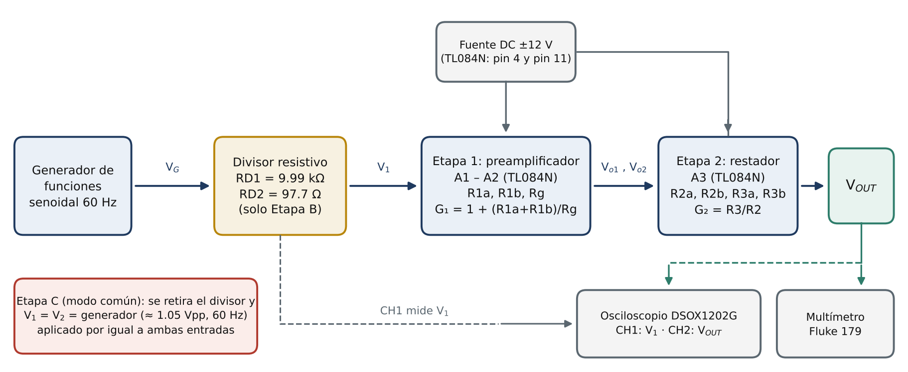
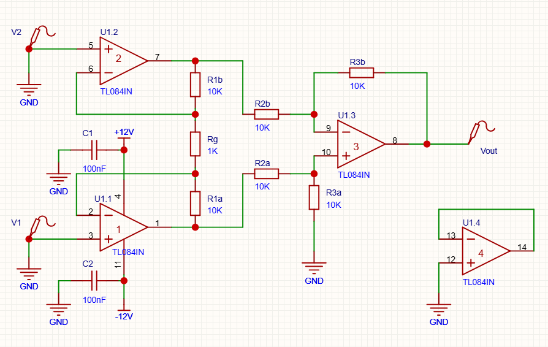
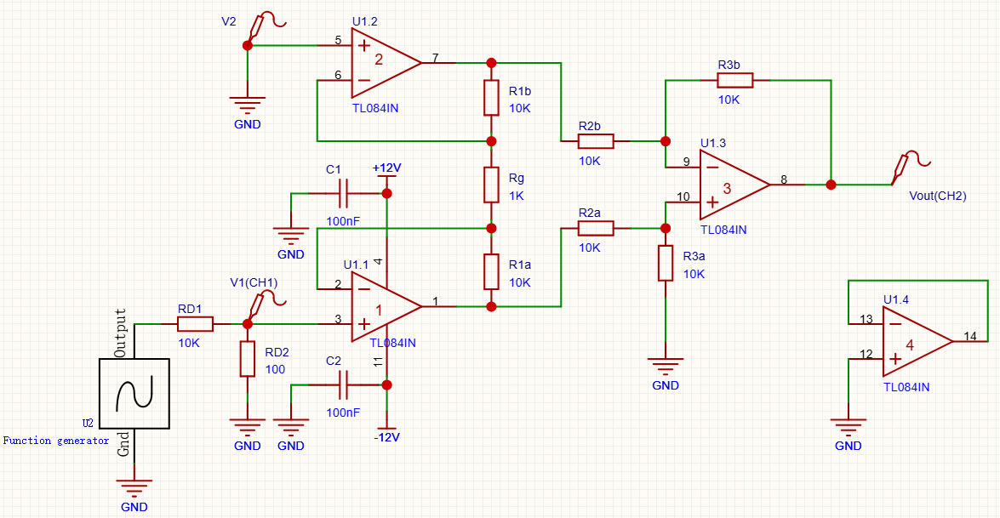
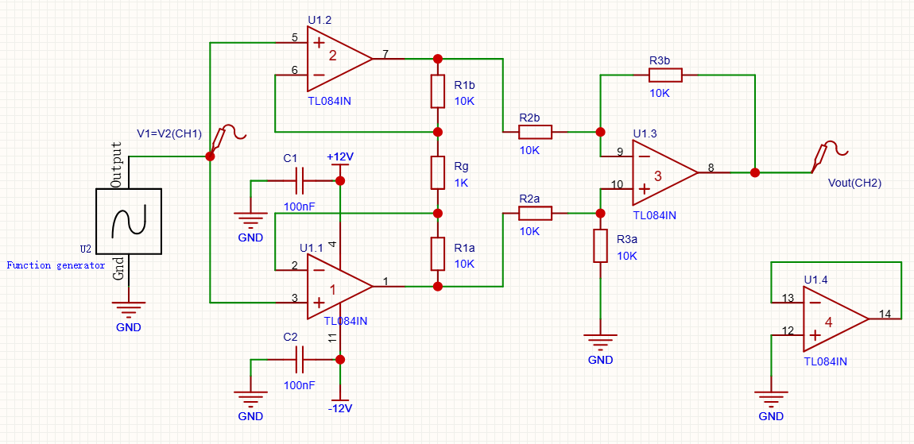
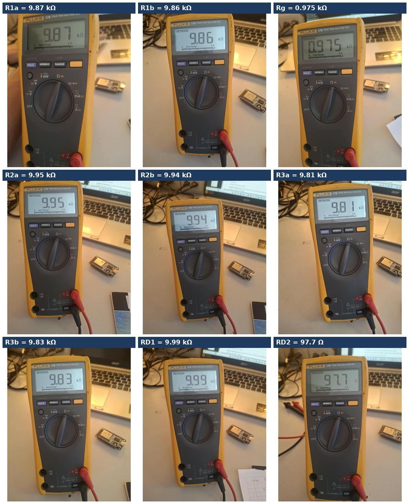

# Amplificador de Instrumentación de Tres Op-Amps y Rechazo de Modo Común

**Informe de Laboratorio N.º 3 — Instrumentación Biomédica III**
*Escuela Profesional de Ingeniería Biomédica — Universidad Nacional Mayor de San Marcos (UNMSM)*

---

## 1. Resumen

En esta experiencia se armó sobre protoboard un amplificador de instrumentación de tres amplificadores operacionales (**TL084N**, alimentación de ±12 V) con ganancia diferencial de diseño igual a **21** ($R_{1a}=R_{1b}=R_2=R_3=10\text{ k}\Omega$ y $R_g=1\text{ k}\Omega$), y se verificaron a 60 Hz sus dos comportamientos característicos.

Con una señal diferencial de **11.3 mVpp**, comparable a un biopotencial, la salida fue de **233 mVpp**, lo que corresponde a una ganancia medida $A_d = 20.619$ frente a $20.969$ calculada con las resistencias realmente medidas (diferencia de −1.7 %). Con una señal de modo común de **1.05 Vpp** aplicada por igual a ambas entradas, la salida fue de solo **19 mVpp** ($A_{cm} = 0.0181$), de modo que la razón de rechazo de modo común resultó **CMRR = 61.13 dB**.

La salida de la Etapa C contiene también ruido e interferencia, por lo que el CMRR debe leerse como una **cota inferior**: con las resistencias medidas, el desapareamiento del restador solo explicaría $A_{cm}\approx 0.0015$ (≈ 82.9 dB). El circuito amplifica ≈ 20 veces la señal diferencial y atenúa ≈ 35 dB la de modo común, pero su rechazo medido **no basta por sí solo para un electrocardiógrafo**, donde se requieren etapas adicionales como el circuito de pierna derecha.

---

## 2. Fundamento y Diagrama de Bloques

Un amplificador diferencial entrega $V_{out} = A_d V_d + A_{cm} V_{cm}$, con $V_d = V_2 - V_1$ y $V_{cm} = (V_1+V_2)/2$. En biopotenciales la señal útil es diferencial (≈ 1 mV en ECG) y la interferencia de red de 60 Hz aparece casi igual en ambos electrodos (modo común).

El circuito consta de una **primera etapa** (A1 y A2, acoplados por $R_g$) con ganancia unitaria para el modo común y $1 + (R_{1a}+R_{1b})/R_g$ para la diferencial, y de una **segunda etapa** restadora (A3) con ganancia $R_3/R_2$:

$$A_{d,\text{teo}} = \left[1 + \frac{R_{1a}+R_{1b}}{R_g}\right]\cdot\frac{1}{2}\left(\frac{R_{3a}}{R_{2a}} + \frac{R_{3b}}{R_{2b}}\right)$$

$$\text{CMRR (dB)} = 20\log_{10}\left|\frac{A_d}{A_{cm}}\right| \qquad A_{cm,\text{restador}} = \frac{k_b - k_a}{1 + k_b},\quad k_a=\frac{R_{3a}}{R_{2a}},\; k_b=\frac{R_{3b}}{R_{2b}}$$

*Figura 1. Diagrama de bloques: generador de funciones, divisor resistivo (solo Etapa B), preamplificación diferencial (A1–A2), restador (A3) y medición con osciloscopio y multímetro.*

---

## 3. Esquemáticos del Montaje

El **TL084N** (DIP-14) aloja los tres amplificadores del circuito; el cuarto se configura como seguidor con la entrada no inversora a GND. Cada pin de alimentación lleva un capacitor de 100 nF a GND.

*Figura 3. Etapa A — montaje base con V1 y V2 a tierra (verificación de offset).*

<!-- POR CONFIRMAR: fase de VOUT respecto a V1. Revisar que el cableado físico coincida con este esquemático (O1 -> R2a -> pin 10; O2 -> R2b -> pin 9) antes de describir la polaridad. -->

### Lista de conexiones (pin a pin)

| Elemento | Conexión |
|:--|:--|
| **V1** | Pin 3 (A1 +) |
| **V2** | Pin 5 (A2 +) |
| **Nodo NA** | Pin 2 (A1 −) · $R_g$ · $R_{1a}$ |
| **Nodo NB** | Pin 6 (A2 −) · $R_g$ · $R_{1b}$ |
| **Salida A1** (pin 1) | $R_{1a}$ → $R_{2a}$ → pin 10 (A3 +), con $R_{3a}$ a GND |
| **Salida A2** (pin 7) | $R_{1b}$ → $R_{2b}$ → pin 9 (A3 −), con $R_{3b}$ de pin 8 a pin 9 |
| **VOUT** | Pin 8 (salida de A3) |
| **A4 (sin uso)** | Pin 13 unido a pin 14; pin 12 a GND |
| **Alimentación** | Pin 4 = +12 V · Pin 11 = −12 V · 100 nF de cada uno a GND |

### Entradas según la etapa

| Etapa | V1 | V2 |
|:--|:--|:--|
| **A** — offset | GND | GND |
| **B** — señal diferencial | Generador → $R_{D1}$ (10 kΩ) → V1, con $R_{D2}$ (100 Ω) a GND | GND |
| **C** — modo común | Salida directa del generador | Unida a V1 |

*Figura 8. Etapa B — divisor resistivo que atenúa 1 Vpp a ≈ 9.7 mVpp (orden de un biopotencial).*

*Figura 9. Etapa C — la misma señal del generador se aplica a V1 y V2.*

---

## 4. Procedimiento para Replicar la Experiencia

1. **Medir y aparear.** Mide cada resistencia con el multímetro y elige los pares $R_{2a}$–$R_{2b}$ y $R_{3a}$–$R_{3b}$ más parecidos entre sí.
2. **Armar** el circuito de la Etapa A con la fuente apagada, siguiendo la lista de conexiones. Mantén cables cortos y una tierra común.
3. **Verificar la alimentación** antes de energizar: $+12.00\text{ V}$ en el pin 4 y $-12.00\text{ V}$ en el pin 11.
4. **Offset.** Con V1 y V2 a GND, mide la tensión continua en VOUT.
5. **Configurar los instrumentos.** Generador: senoidal, **60 Hz**, **1 Vpp**, offset 0 V, carga **High-Z**. Osciloscopio: puntas ×1, CH1 = V1, CH2 = VOUT. Usa la medida Pico-Pico y el modo de adquisición Promedio.
6. **Etapa B.** Agrega el divisor $R_{D1}/R_{D2}$, deja V2 a GND y mide $V_{pp}$ de V1 y VOUT.
7. **Etapa C.** Retira el divisor, une V1 con V2 y conéctalos al generador. Mide $V_{pp}$ de la entrada común y de VOUT.

---

## 5. Nuestros Resultados Metrológicos

### Resistencias medidas (Fluke 179)

| Resistencia | $R_{1a}$ | $R_{1b}$ | $R_g$ | $R_{2a}$ | $R_{2b}$ | $R_{3a}$ | $R_{3b}$ | $R_{D1}$ | $R_{D2}$ |
|:--|:-:|:-:|:-:|:-:|:-:|:-:|:-:|:-:|:-:|
| Nominal | 10 kΩ | 10 kΩ | 1 kΩ | 10 kΩ | 10 kΩ | 10 kΩ | 10 kΩ | 10 kΩ | 100 Ω |
| **Medida** | 9.87 kΩ | 9.86 kΩ | 0.975 kΩ | 9.95 kΩ | 9.94 kΩ | 9.81 kΩ | 9.83 kΩ | 9.99 kΩ | 97.7 Ω |

*Figura 2. Medición de las resistencias con el multímetro Fluke 179.*

### Tabla consolidada de parámetros medidos y calculados

| Parámetro / Condición | Símbolo | Valor | Unidad |
|:--|:-:|:-:|:-:|
| Alimentación | $\pm V_{cc}$ | **±12.00** | V |
| Offset de VOUT con entradas a GND | $V_{os}$ | **15** | mV |
| Entrada diferencial (Etapa B) | $V_1$ | **11.3** | mVpp |
| Salida diferencial (Etapa B) | $V_{out}$ | **233** | mVpp |
| Ganancia diferencial teórica (resistencias medidas) | $A_{d,\text{teo}}$ | **20.969** | V/V |
| Ganancia diferencial medida | $A_d$ | **20.619** | V/V |
| Diferencia medida vs. teórica | — | **−1.7** | % |
| Entrada de modo común (Etapa C) | $V_{cm}$ | **1.05** | Vpp |
| Salida de modo común (Etapa C) | $V_{out}$ | **19** | mVpp |
| Ganancia de modo común | $A_{cm}$ | **0.0181** | V/V |
| Razón de rechazo de modo común | CMRR | **61.13** (cota inferior) | dB |
| $A_{cm}$ del restador con resistencias medidas | — | **0.00151** | V/V |
| CMRR esperado solo por apareamiento | — | **82.9** | dB |
| Peor caso con resistencias de 5 % sin aparear | $A_{cm}$ / CMRR | **0.105 / 46.0** | — / dB |
| Peor caso con resistencias de 1 % sin aparear | $A_{cm}$ / CMRR | **0.0202 / 60.3** | — / dB |

## 6. Componentes e Instrumental Utilizados

- Circuito integrado **TL084N** (cuatro op-amps con entrada JFET, DIP-14)
- Resistencias: 7 de 10 kΩ, 1 de 1 kΩ y 1 de 100 Ω
- 2 capacitores cerámicos de 100 nF (desacople de alimentación)
- Protoboard y ≈ 20 cables jumper macho-macho; cable BNC–caimán
- Fuente de alimentación de banco en modo dual (±12 V)
- Generador de funciones (senoidal, 60 Hz, 1 Vpp, carga High-Z)
- Osciloscopio digital Keysight InfiniiVision DSOX1202G (2 canales, 200 MHz, 2 GSa/s)
- Multímetro digital Fluke 179 True RMS

---

## 7. Integrantes

- **Sotomayor Villanueva, Genny Solangch** — *Código: 23190393*
- **Lázaro Canales, Jair Renato** — *Código: 23190377*
- **Arroyo Ramos, Rosbeth Nayelhy** — *Código: 23190114*
