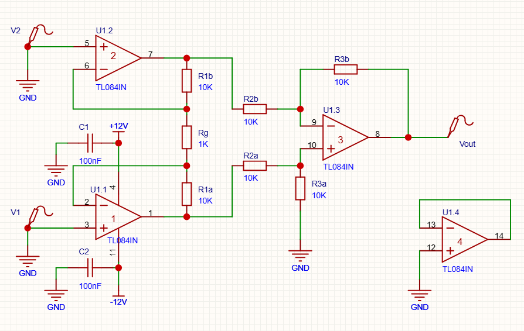
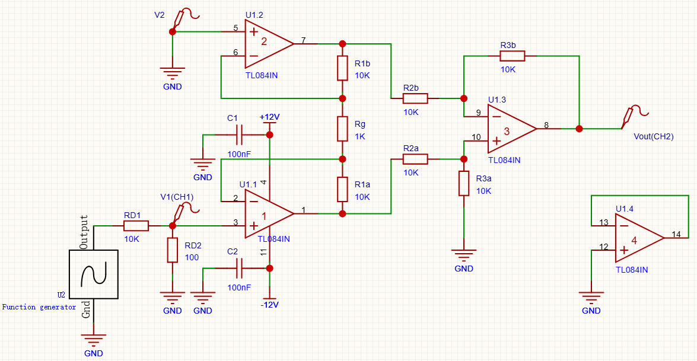
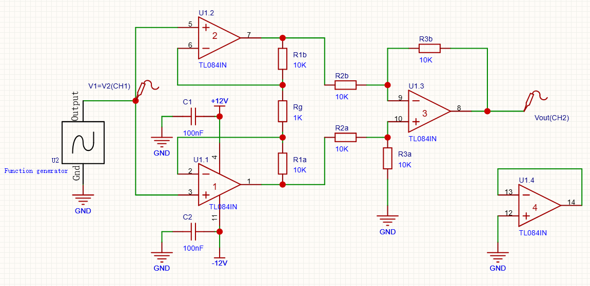

# 2. El circuito

## Topología

Amplificador de instrumentación clásico de **tres op-amps**:

1. **Primera etapa** (A1 y A2): dos amplificadores no inversores acoplados por Rg. Dan ganancia
   diferencial `1 + (R1a + R1b)/Rg` y ganancia **1** para el modo común, porque Rg no conduce
   corriente cuando ambas entradas se mueven juntas.
2. **Segunda etapa** (A3): restador con ganancia `R3/R2`.

Con los valores de diseño: `Ad = (1 + 20 kΩ / 1 kΩ) · (10 kΩ / 10 kΩ) = 21`.

## Lista de conexiones (netlist)

Pinout del TL084N (DIP-14): 1 OUT1 · 2 IN1− · 3 IN1+ · 4 V+ · 5 IN2+ · 6 IN2− · 7 OUT2 ·
8 OUT3 · 9 IN3− · 10 IN3+ · 11 V− · 12 IN4+ · 13 IN4− · 14 OUT4.

| Nodo | Conexiones |
|---|---|
| **V1** | pin 3 (A1 +) |
| **V2** | pin 5 (A2 +) |
| **NA** | pin 2 (A1 −) · Rg (extremo A) · R1a (extremo A) |
| **NB** | pin 6 (A2 −) · Rg (extremo B) · R1b (extremo A) |
| **O1** | pin 1 (salida A1) · R1a (extremo B) · R2a (extremo A) |
| **O2** | pin 7 (salida A2) · R1b (extremo B) · R2b (extremo A) |
| **NP** | R2a (extremo B) · pin 10 (A3 +) · R3a (extremo A) |
| **NM** | R2b (extremo B) · pin 9 (A3 −) · R3b (extremo A) |
| **VOUT** | pin 8 (salida A3) · R3b (extremo B) |
| **GND** | R3a (extremo B) · pin 12 (A4 +) · C1 · C2 · tierra de fuente, generador y osciloscopio |
| **+12 V** | pin 4 · C1 |
| **−12 V** | pin 11 · C2 |
| *(A4 sin uso)* | pin 13 unido a pin 14 (seguidor), pin 12 a GND |

### Entradas según la etapa

| Etapa | V1 | V2 |
|---|---|---|
| **A** – verificación de offset | GND | GND |
| **B** – señal diferencial | Generador → **RD1 (10 kΩ)** → V1, con **RD2 (100 Ω)** de V1 a GND | GND |
| **C** – modo común | Salida directa del generador (sin divisor) | **Unida a V1** |

El divisor de la Etapa B atenúa el generador (1 Vpp) a
`1 V · 97.7 / (9990 + 97.7) ≈ 9.7 mVpp`, el orden de magnitud de un biopotencial.

## Ecuaciones

| N.º | Ecuación | Uso |
|---|---|---|
| (1) | `Vd = V2 − V1`, `Vcm = (V1 + V2)/2` | Definiciones |
| (2) | `Vout = (1 + 2R1/Rg)·(R3/R2)·(V2 − V1)` | Ganancia ideal |
| (3) | `Ad,teo = [1 + (R1a+R1b)/Rg] · ½·(R3a/R2a + R3b/R2b)` | Ganancia con resistencias medidas |
| (4) | `CMRR = |Ad / Acm|`, `CMRR(dB) = 20·log10(|Ad/Acm|)` | Rechazo de modo común |
| (5) | `Acm,restador = (kb − ka)/(1 + kb)`, con `ka = R3a/R2a`, `kb = R3b/R2b` | Modo común por desapareamiento |

> Nota sobre (5): el análisis nodal exacto da `(ka − kb)/(1 + ka)` (ver `src/ai3op/modelo.py`).
> Para k ≈ 1 la diferencia numérica es menor a 0.2 %.

## Signo de la salida (⚠️ POR CONFIRMAR)

Con las conexiones de la tabla (O1 → R2a → pin 10 y O2 → R2b → pin 9), el análisis da
`Vout = +Ad·(V1 − V2)`, es decir, **en fase** con V1 cuando V2 está a GND. En el informe, en cambio,
la captura del osciloscopio (Figura 6) muestra **contrafase (180°)** y se escribe `Vout = Ad·(V2 − V1)`.
Esta discrepancia debe resolverse antes de publicar; ver `PENDIENTES.md`.
