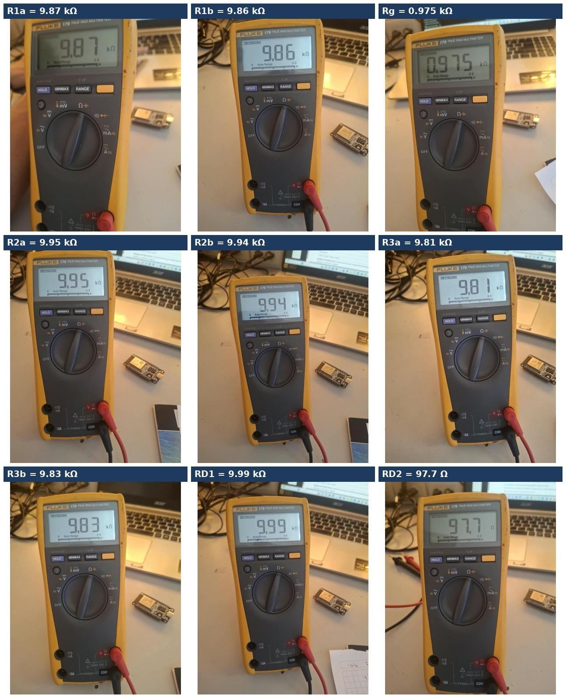
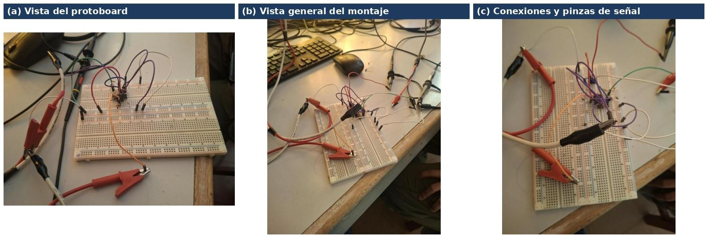
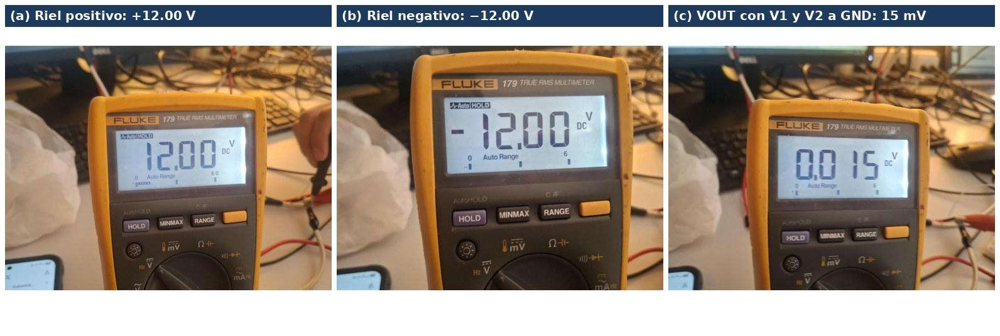
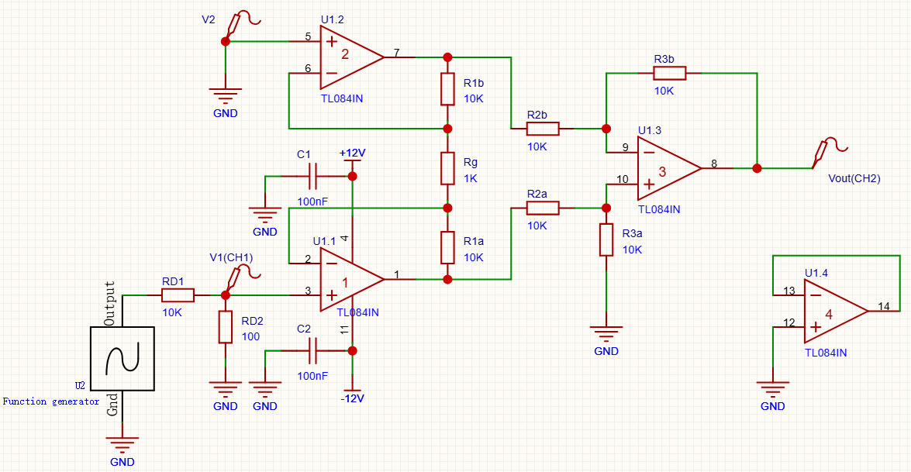
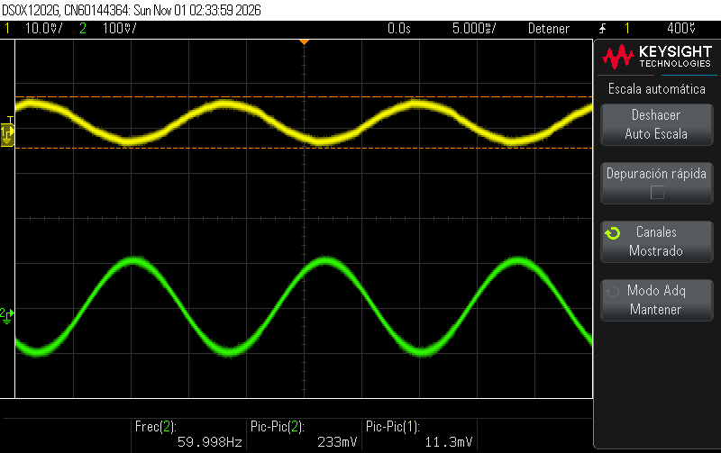
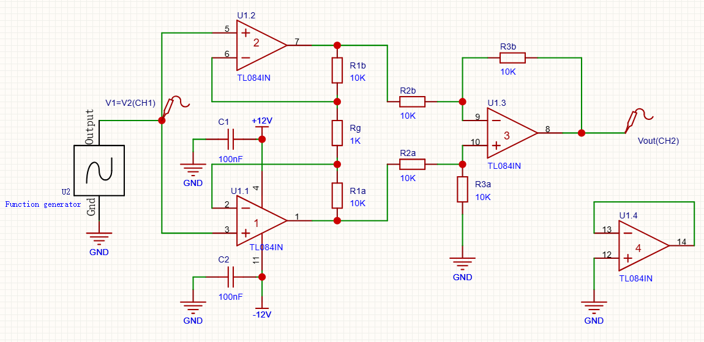
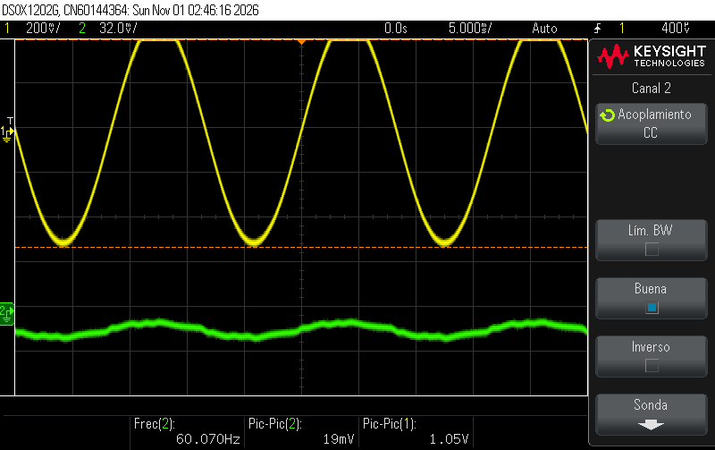

# 3. Procedimiento paso a paso

Tiempo estimado: 2 horas. Registra **tus** mediciones en `data/` (ver `data/README.md`).
Los pasos marcados con *(Guía, paso N)* corresponden a la guía de laboratorio del curso.

---

## Paso 1 · Medir y aparear las resistencias *(Guía, paso 1)*

1. Con el multímetro en Ω, mide cada resistencia **fuera del circuito** y anota el valor.
2. De tu lote, elige los pares **R2a–R2b** y **R3a–R3b** con valores lo más parecidos posible.
   Este apareamiento es lo que más influye en el CMRR (ver `docs/05-resultados-esperados.md`).
3. Completa `data/resistencias_medidas.csv`.



✅ **Punto de control:** los valores medidos deben estar dentro de la tolerancia de tus resistencias
(5 % ⇒ 9.5–10.5 kΩ para las de 10 kΩ).

---

## Paso 2 · Armar la Etapa A

Con la **fuente apagada**:

1. Coloca el TL084N cruzando el canal central del protoboard (muesca hacia un lado, pin 1 identificado).
2. Conecta los capacitores de 100 nF: **C1** de pin 4 (+12 V) a GND y **C2** de pin 11 (−12 V) a GND, pegados al integrado.
3. Cablea según la tabla de conexiones de [`docs/02-circuito.md`](02-circuito.md). Orden sugerido:
   primero A1 y A2 con R1a, Rg, R1b; luego el restador A3 con R2a, R2b, R3a, R3b; por último el A4 como seguidor (pin 13 ↔ 14, pin 12 a GND).
4. Lleva **V1** y **V2** a GND con jumpers.
5. Mantén los cables cortos y usa un único punto de tierra común para fuente, generador y osciloscopio.



✅ **Punto de control:** revisa el cableado contra el esquemático *dos veces* antes de energizar.

---

## Paso 3 · Verificar la alimentación

1. Ajusta la fuente en modo dual (tracking) a **±12 V** y **apágala** de nuevo.
2. Conéctala al circuito (+12 V → pin 4, −12 V → pin 11, común → GND) y enciéndela.
3. Mide con el multímetro en los pines 4 y 11 respecto de GND.

✅ **Punto de control:** **+12.00 V** y **−12.00 V** (±0.05 V). Si no, apaga y revisa.

---

## Paso 4 · Offset de salida *(Guía, paso 5)*

Con V1 y V2 a GND, mide la tensión **continua** en VOUT (pin 8) respecto de GND.



✅ **Punto de control:** en el informe fue **15 mV** (≈ 0.7 mV referidos a la entrada). Debe ser de unos
pocos mV a algunas decenas de mV; si es de volts, la salida está saturada (ver `docs/04-solucion-de-problemas.md`).

Registra el valor en `data/mediciones_dc.csv`.

---

## Paso 5 · Configurar generador y osciloscopio

| Instrumento | Ajuste |
|---|---|
| Generador | Senoidal · **60 Hz** · **1 Vpp** · offset **0 V** · carga **High-Z** |
| Osciloscopio | Puntas en **×1** · CH1 = V1 · CH2 = VOUT · disparo en CH1 · CH2 con acoplamiento **CC** |

Antes de conectar el generador al circuito, míralo directamente en el osciloscopio y confirma ≈ 1 Vpp a 60 Hz.

> Consejo: activa **Medidas → Pico-Pico** para CH1 y CH2 y **Frecuencia** en CH2, y usa el modo de
> adquisición **Promedio** (p. ej. 16 o 64) para reducir el ruido en la lectura de Vpp.

---

## Paso 6 · Etapa B: señal diferencial *(Guía, paso 8)*

1. Con la fuente del generador apagada (salida desactivada), agrega el divisor: generador → **RD1 (10 kΩ)** → nodo **V1**, y **RD2 (100 Ω)** de V1 a GND. **V2 permanece a GND.**
2. Activa la salida del generador.
3. Lee: Vpp de CH1 (V1), Vpp de CH2 (VOUT), frecuencia y relación de fase.
4. Anótalo en `data/mediciones_osciloscopio.csv`, fila `B`.




✅ **Punto de control (informe):** V1 ≈ **11.3 mVpp**, VOUT ≈ **233 mVpp**, f ≈ 60 Hz, ganancia ≈ **20.6**.
Se espera V1 ≈ 9.7 mVpp por el divisor; la lectura puede ser algo mayor porque el ruido suma a una señal tan pequeña.
Fase de VOUT respecto a V1: ver `PENDIENTES.md` (⚠️ POR CONFIRMAR).

---

## Paso 7 · Etapa C: señal de modo común *(Guía, paso 10)*

1. Desactiva la salida del generador y **retira** RD1 y RD2.
2. Une **V1 y V2** entre sí y conéctalos a la salida del generador (la misma señal en ambas entradas).
3. Activa la salida. En el informe: CH1 a 200 mV/div y CH2 a 32 mV/div.
4. Lee Vpp de CH1 (entrada común), Vpp de CH2 (VOUT) y frecuencia de CH2.
5. Anótalo en `data/mediciones_osciloscopio.csv`, fila `C`.




✅ **Punto de control (informe):** entrada ≈ **1.05 Vpp**, VOUT ≈ **19 mVpp** a ≈ 60 Hz.
Una entrada ~93 veces mayor produce una salida ~12 veces **menor** que en la Etapa B.

---

## Paso 8 · Análisis

```bash
python -m ai3op --datos data --salida results
```

Compara la salida con la tabla de `docs/05-resultados-esperados.md`.

## Paso 9 · Cierre

Apaga el generador y luego la fuente. Desmonta el circuito y guarda tus fotos y capturas.
