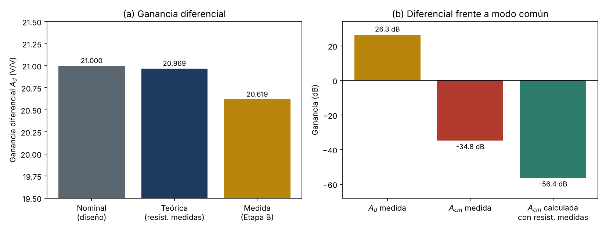
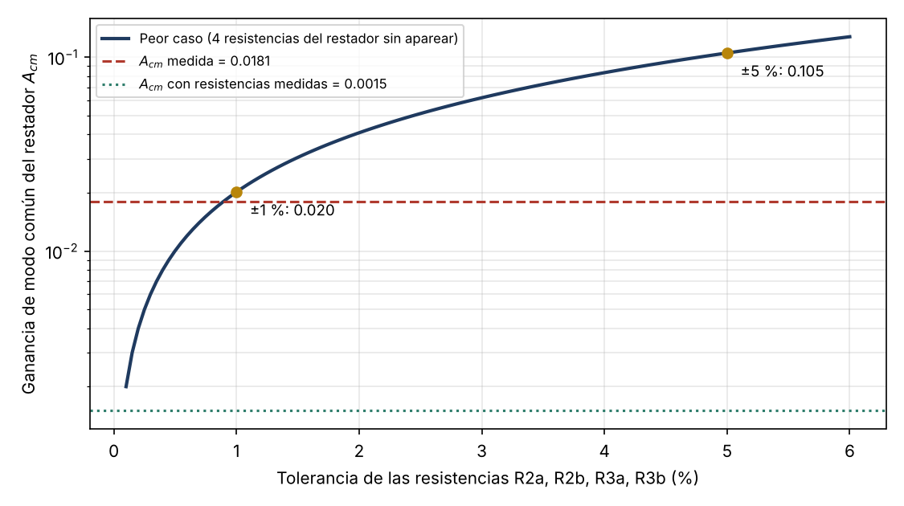

# 5. Resultados esperados y cómo interpretarlos

Resultados obtenidos en el informe (30/10/2026), con resistencias de 5 % apareadas por medición:

| Magnitud | Valor del informe | Rango razonable al replicar |
|---|---|---|
| Alimentación | ±12.00 V | ±12.00 V ± 0.05 V |
| Offset de VOUT (entradas a GND) | 15 mV | pocos mV a algunas decenas de mV |
| V1 en Etapa B (divisor) | 11.3 mVpp (esperado 9.7 mVpp) | 9–12 mVpp |
| VOUT en Etapa B | 233 mVpp | ≈ 20 × V1 |
| **Ad medida** | **20.619** | 19.5 – 22 |
| Ad teórica (resistencias medidas) | 20.969 | se calcula con tus valores |
| Diferencia medida vs teórica | −1.7 % | dentro de ≈ ±5 % |
| Vcm en Etapa C | 1.05 Vpp | ≈ 1 Vpp |
| VOUT en Etapa C | 19 mVpp | de pocos mV a ≈ 100 mVpp |
| **Acm medida** | **0.0181** | ≲ 0.1 |
| **CMRR medido** | **61.13 dB** | ≳ 46 dB; mayor con mejor apareamiento |

## Cómo se relaciona el CMRR con el apareamiento

| Situación | Acm | CMRR (Ad ≈ 21) |
|---|---|---|
| 4 resistencias de **5 %** sin aparear (peor caso) | 0.105 | 46.0 dB |
| 4 resistencias de **1 %** sin aparear (peor caso) | 0.0202 | 60.3 dB |
| Resistencias de 5 % **apareadas por medición** (solo por apareamiento) | 0.0015 | 82.9 dB |
| **Medido en el laboratorio** | **0.0181** | **61.1 dB** |

El valor medido queda entre el peor caso de 5 % y el apareamiento ideal. Lo explican el ruido y la
interferencia de 60 Hz presentes en VOUT, las capacitancias parásitas del protoboard, el desbalance
de impedancias de fuente y el CMRR finito de los op-amps. **Por eso el CMRR medido debe leerse como
una cota inferior.** (Detalle en la sección 5.2 del informe.)

## Limitaciones conocidas (para quien replique)

* La señal de prueba (60 Hz) coincide con la frecuencia de la red: no se distingue interferencia captada de fuga real de modo común. Repite a 100 Hz o 1 kHz.
* Lecturas de Vpp de señales de ~10 mV tienen incertidumbre de varios cientos de µV; usa promediado.
* El protoboard añade capacitancias y resistencias de contacto no controladas.
* Un CMRR de 61 dB **no basta para ECG**: se requieren mayor CMRR, blindaje y circuito de pierna derecha.
